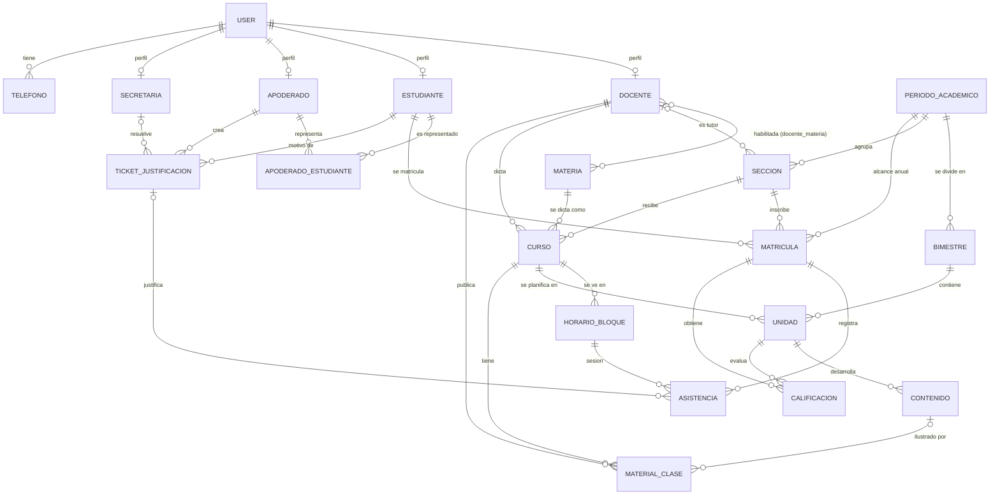

> ⚠️ **OBSOLETO — no usar.** Este documento es la propuesta v2 y fue reemplazado por `CONTEXT.md` v3.1. Varias decisiones de aquí (por ejemplo, `PeriodoAcademico` como año escolar) ya no rigen. La fuente de verdad es `CONTEXT.md`.

# Educa360 — Modelo de entidades (propuesta v2)

Leyenda de estado: ✅ existe y no cambia · 🔧 existe y se modifica · 🆕 nueva (propuesta) · 📋 ya estaba en el roadmap de `CONTEXT.md`, aquí se define completa.

Todas las entidades extienden `Auditable` (`id` Long IDENTITY, `createdAt`, `updatedAt`); no se repiten en cada tabla.

---

## 1. Idea central del rediseño

1. **`PeriodoAcademico` pasa a ser el AÑO ESCOLAR** (ej. "Año Escolar 2026"). Es el ancla anual de **secciones, cursos, horarios y matrículas**: se arman una sola vez al año, no cada bimestre.
2. **`Bimestre` 🆕** divide el año en etapas de evaluación (I–IV). Es solo una ventana de tiempo donde viven las unidades, las notas y la asistencia.
3. **`Unidad` 🆕** es la planificación del docente: *un curso, en un bimestre*, se enseña en una o más unidades.
4. **`Contenido` 🆕** son los temas/sesiones dentro de una unidad. Los materiales de clase cuelgan de un contenido.
5. **`Calificacion` y `Asistencia`** cuelgan de la **`Matricula`** (no del estudiante suelto), para garantizar que el alumno realmente pertenece a esa sección y año.

Jerarquía académica resumida:

```
PeriodoAcademico (año)
 ├── Bimestre (I..IV)
 └── Seccion (3°A) ── Matricula (alumno en la sección, 1 por año)
      └── Curso (materia + docente) ── HorarioBloque
           └── Unidad (curso × bimestre)
                └── Contenido (tema / sesión) ── MaterialClase
```

---

## 2. Diagrama entidad–relación



---

## 3. Entidades

### 3.1 Identidad y personas

#### `User` ✅ — tabla `users`
| Atributo | Tipo | Restricciones |
|---|---|---|
| email | String | único, obligatorio, formato email |
| password | String | obligatorio, hash BCrypt, write-only en JSON |
| nombres | String | obligatorio |
| apellidos | String | obligatorio |
| dni | String | único, obligatorio |
| rol | enum `Role` | `ADMIN`, `SECRETARIA`, `DOCENTE`, `ESTUDIANTE`, `APODERADO` |
| activo | boolean | por defecto `true` (baja lógica) |

Relaciones: **1—N** `Telefono` (cascade ALL, orphanRemoval). **1—0..1** con cada perfil (`Docente`, `Estudiante`, `Apoderado`, `Secretaria`). Un `User` con rol `ADMIN` no tiene tabla de perfil.

#### `Telefono` ✅ — `telefonos`
`numero` (String, obligatorio), `user_id` (FK obligatoria). Único `(user_id, numero)`. Relación **N—1** `User`.
> Regla de negocio: el `ESTUDIANTE` no registra teléfonos propios (es menor de edad; se contacta vía apoderado).

#### `Docente` ✅ — `docentes`
`user_id` (FK única, **1—1** `User`), `titulo` (String, opcional).
Relaciones: **N—N** `Materia` por `docente_materia` (único `(docente_id, materia_id)`); **1—N** `Curso`; **1—N** `Seccion` (como tutor); **1—N** `MaterialClase`.

#### `Estudiante` ✅ — `estudiantes`
`user_id` (FK única, **1—1** `User`), `fechaNacimiento` (LocalDate, obligatoria), `estado` (enum `ACTIVO`, `TRASLADADO`, `RETIRADO`, `EGRESADO`).
Relaciones: **1—N** `Matricula`; **N—N** `Apoderado` vía `ApoderadoEstudiante`; **1—N** `TicketJustificacion`.

#### `Apoderado` ✅ — `apoderados`
`user_id` (FK única, **1—1** `User`). Relaciones: **1—N** `ApoderadoEstudiante` (cascade ALL); **1—N** `TicketJustificacion`.

#### `Secretaria` ✅ — `secretarias`
`user_id` (FK única, **1—1** `User`). Relación: **1—N** `TicketJustificacion` (los que resuelve).

#### `ApoderadoEstudiante` ✅ — `apoderado_estudiante` (tabla puente con datos propios)
| Atributo | Tipo | Notas |
|---|---|---|
| apoderado_id | FK → Apoderado | obligatoria |
| estudiante_id | FK → Estudiante | obligatoria |
| parentesco | enum | `PADRE`, `MADRE`, `TUTOR`, `HERMANO`, `OTRO` |
| responsablePrincipal | boolean | obligatorio |
| activo | boolean | por defecto `true` |

Único `(apoderado_id, estudiante_id)`. Resuelve la **N—N** Apoderado↔Estudiante.

---

### 3.2 Catálogo y estructura anual

#### `Materia` ✅ — `materias`
`nombre` (único, obligatorio), `descripcion` (String), `activa` (boolean).
Relaciones: **N—N** `Docente`; **1—N** `Curso`.
Es el catálogo ("lo que se enseña"). No depende del año.

#### `PeriodoAcademico` 🔧 — `periodos_academicos` (**ahora es el año escolar**)
| Atributo | Tipo | Restricciones |
|---|---|---|
| nombre | String | único. Ej.: "Año Escolar 2026" |
| anio | Integer 🆕 | único (2026). Evita deducirlo del nombre |
| fechaInicio | LocalDate | obligatoria |
| fechaFin | LocalDate | obligatoria, ≥ inicio |
| estado | enum | `ABIERTO` / `CERRADO`; nace `CERRADO` |

Relaciones: **1—N** `Bimestre`; **1—N** `Seccion`; **1—N** `Matricula` (por el `periodo_id` desnormalizado, ver §3.3).
Reglas: solo **un** período `ABIERTO` (también como **índice único parcial** en BD); no se solapa con otro período; no se puede cerrar si tiene bimestres `ABIERTO` (409).

#### `Bimestre` 🆕 — `bimestres`
| Atributo | Tipo | Restricciones |
|---|---|---|
| periodo_id | FK → PeriodoAcademico | obligatoria |
| numero | Integer | 1..4 |
| nombre | String | "Bimestre I" (derivable de `numero`) |
| fechaInicio / fechaFin | LocalDate | obligatorias, dentro del año, sin solape con otro bimestre del mismo año |
| estado | enum | `ABIERTO` / `CERRADO`; nace `CERRADO` |

Único `(periodo_id, numero)`. Índice único parcial: **un solo `ABIERTO` por período**.
Relaciones: **N—1** `PeriodoAcademico`; **1—N** `Unidad`.
Reglas: solo se abre si el año está `ABIERTO`; cerrar un bimestre bloquea nuevas notas y asistencia fuera de él.
> Si el colegio prefiere trimestres o semestres, solo cambia el rango de `numero`.

#### `Seccion` 🔧 — `secciones`
`grado` (Integer 1..5), `letra` (String `[A-Z]`), `aula` (String libre, opcional), `tutor_id` (FK → Docente, opcional), `periodo_id` (FK → PeriodoAcademico, obligatoria).
Único `(grado, letra, periodo_id)`.
**Cambio de significado:** ahora `periodo_id` es el **año**, así "3°A 2026" es una sola fila que dura todo el año.
Relaciones: **N—1** `PeriodoAcademico`; **N—1** `Docente` (tutor); **1—N** `Curso`; **1—N** `Matricula`.

#### `Curso` ✅ — `cursos`
`docente_id`, `materia_id`, `seccion_id` (FKs obligatorias). Único `(materia_id, seccion_id)`.
Relaciones: **N—1** `Docente`, `Materia`, `Seccion`; **1—N** `HorarioBloque`; **1—N** `Unidad`; **1—N** `MaterialClase`.
Reglas ya vigentes: materia activa, materia habilitada al docente, sin solapes de horario.
Regla nueva: **no se puede eliminar** un curso con unidades, notas o asistencia (409); hoy es baja física.

#### `HorarioBloque` ✅ — `horario_bloques`
`curso_id` (FK), `dia` (enum `DiaSemana` `LUNES`..`SABADO`), `horaInicio`, `horaFin` (LocalTime). Único `(curso_id, dia, hora_inicio)`. Intervalos `[inicio, fin)`.
Relaciones: **N—1** `Curso`; **1—N** `Asistencia`.

#### `Matricula` 🔧 — `matriculas` (**anual**)
| Atributo | Tipo | Restricciones |
|---|---|---|
| estudiante_id | FK → Estudiante | obligatoria |
| seccion_id | FK → Seccion | obligatoria |
| periodo_id | FK → PeriodoAcademico 🆕 | **desnormalizado** desde `seccion.periodo` |
| estado | enum | `PENDIENTE` → `PAGADO` (acción de SECRETARIA) |
| situacionFinal | enum 🆕 | `EN_CURSO`, `APROBADO`, `DESAPROBADO`, `RETIRADO`; por defecto `EN_CURSO` |

Únicos: `(estudiante_id, seccion_id)` y **`(estudiante_id, periodo_id)`** 🆕. Hoy la regla "una matrícula por período" solo está en `MatriculaService`; con el nuevo único la garantiza la BD.
Relaciones: **N—1** `Estudiante`, `Seccion`, `PeriodoAcademico`; **1—N** `Asistencia`; **1—N** `Calificacion`.
Esta es **la matrícula vigente**: la del período `ABIERTO`.
> Así el pago es anual (una sola vez) y las notas/asistencias se acotan al alumno inscrito.

---

### 3.3 Planificación del docente (nuevo)

#### `Unidad` 🆕 — `unidades`
| Atributo | Tipo | Restricciones |
|---|---|---|
| curso_id | FK → Curso | obligatoria |
| bimestre_id | FK → Bimestre | obligatoria; el bimestre debe pertenecer al mismo año que la sección del curso |
| numero | Integer | orden dentro del curso y bimestre |
| titulo | String | obligatorio. Ej.: "Funciones lineales" |
| descripcion | String (text) | opcional: competencias / propósito |
| fechaInicio / fechaFin | LocalDate | opcionales; deben caer dentro del bimestre |
| estado | enum | `BORRADOR` / `PUBLICADA` (el estudiante y apoderado solo ven las publicadas) |

Único `(curso_id, bimestre_id, numero)`.
Relaciones: **N—1** `Curso`; **N—1** `Bimestre`; **1—N** `Contenido`; **1—N** `Calificacion`.
Regla: un docente solo crea/edita unidades de **sus** cursos, y solo en el bimestre `ABIERTO` (o en uno futuro, sin cerrar).

#### `Contenido` 🆕 — `contenidos` (tema o sesión dentro de la unidad)
| Atributo | Tipo | Restricciones |
|---|---|---|
| unidad_id | FK → Unidad | obligatoria |
| orden | Integer | posición dentro de la unidad |
| titulo | String | obligatorio. Ej.: "Pendiente de una recta" |
| descripcion | String (text) | opcional |
| fechaPrevista | LocalDate | opcional: cuándo se verá |

Único `(unidad_id, orden)`.
Relaciones: **N—1** `Unidad`; **1—N** `MaterialClase` (opcional).

---

### 3.4 Seguimiento académico (roadmap 📋, ya anclado al nuevo modelo)

#### `Asistencia` 📋 — `asistencias`
| Atributo | Tipo | Restricciones |
|---|---|---|
| matricula_id | FK → Matricula | obligatoria (en lugar de `estudianteId`) |
| bloque_id | FK → HorarioBloque | obligatoria; debe ser de un curso de la sección de la matrícula |
| fecha | LocalDate | obligatoria; debe caer en el día del bloque y dentro del bimestre `ABIERTO` |
| estado | enum | `PRESENTE`, `TARDANZA`, `FALTA`, `JUSTIFICADA` |
| observacion | String | opcional |
| ticket_id | FK → TicketJustificacion 🆕 | opcional; trazabilidad de por qué quedó `JUSTIFICADA` |

Único `(matricula_id, bloque_id, fecha)`. El bimestre **se deduce de `fecha`**, sin columna extra.
Relaciones: **N—1** `Matricula`; **N—1** `HorarioBloque`; **N—0..1** `TicketJustificacion`.

#### `Calificacion` 📋 — `calificaciones`
| Atributo | Tipo | Restricciones |
|---|---|---|
| matricula_id | FK → Matricula | obligatoria |
| unidad_id | FK → Unidad | obligatoria (curso y bimestre salen de la unidad; reemplaza `asignacionId`) |
| criterio | String | competencia o criterio evaluado |
| nota | Decimal(4,2) | `0.00`..`20.00` (escala vigesimal) |
| fechaRegistro | LocalDateTime | automática |

Regla: la sección de la matrícula debe ser la del curso de la unidad; solo el docente del curso califica; el bimestre de la unidad debe estar `ABIERTO`.
Relaciones: **N—1** `Matricula`; **N—1** `Unidad`.
> El **promedio** de unidad, bimestre y año se calcula con consultas (no se guarda). Una tabla snapshot de promedios al cerrar el bimestre queda diferida (ver §6).

#### `TicketJustificacion` 📋 — `tickets_justificacion`
| Atributo | Tipo | Restricciones |
|---|---|---|
| apoderado_id | FK → Apoderado | obligatoria; debe estar vinculado y `activo` con el estudiante |
| estudiante_id | FK → Estudiante | obligatoria |
| fechaInasistencia | LocalDate | obligatoria |
| motivo | String | obligatorio |
| urlArchivoSustento | String | URL de Supabase Storage |
| estado | enum | `PENDIENTE`, `APROBADO`, `RECHAZADO` |
| fechaResolucion | LocalDateTime | al resolver |
| resueltoPor_id | FK → Secretaria 🆕 | quién resolvió |
| observacionesAdmin | String | opcional |

Relaciones: **N—1** `Apoderado`, `Estudiante`, `Secretaria`; **1—N** `Asistencia` (las de ese día).
Regla: al `APROBAR`, las asistencias `FALTA` de esa fecha pasan a `JUSTIFICADA` en la misma transacción.

#### `MaterialClase` 📋 — `materiales_clase`
| Atributo | Tipo | Restricciones |
|---|---|---|
| curso_id | FK → Curso | obligatoria |
| docente_id | FK → Docente | quien lo sube (debe ser el del curso) |
| contenido_id | FK → Contenido 🆕 | opcional; reemplaza el campo suelto `semana/bloque` |
| titulo | String | obligatorio |
| urlArchivo | String | Supabase Storage |
| fechaPublicacion | LocalDateTime | automática |

Relaciones: **N—1** `Curso`; **N—1** `Docente`; **N—0..1** `Contenido`.

---

## 4. Tabla resumen de relaciones

| Origen | Cardinalidad | Destino | Mecanismo |
|---|---|---|---|
| User | 1 — 0..1 | Docente / Estudiante / Apoderado / Secretaria | `user_id` único en el perfil |
| User | 1 — N | Telefono | `telefonos.user_id` |
| Apoderado | N — N | Estudiante | tabla `apoderado_estudiante` (con atributos) |
| Docente | N — N | Materia | tabla `docente_materia` |
| PeriodoAcademico | 1 — N | Bimestre | `bimestres.periodo_id` |
| PeriodoAcademico | 1 — N | Seccion | `secciones.periodo_id` |
| PeriodoAcademico | 1 — N | Matricula | `matriculas.periodo_id` (desnormalizado) |
| Docente | 1 — N | Seccion (tutor) | `secciones.tutor_id` (opcional) |
| Seccion | 1 — N | Curso | `cursos.seccion_id` |
| Seccion | 1 — N | Matricula | `matriculas.seccion_id` |
| Estudiante | 1 — N | Matricula | `matriculas.estudiante_id` (máx. 1 por período) |
| Materia | 1 — N | Curso | `cursos.materia_id` |
| Docente | 1 — N | Curso | `cursos.docente_id` |
| Curso | 1 — N | HorarioBloque | `horario_bloques.curso_id` |
| Curso | 1 — N | Unidad | `unidades.curso_id` |
| Bimestre | 1 — N | Unidad | `unidades.bimestre_id` |
| Unidad | 1 — N | Contenido | `contenidos.unidad_id` |
| Curso | 1 — N | MaterialClase | `materiales_clase.curso_id` |
| Contenido | 1 — N (opcional) | MaterialClase | `materiales_clase.contenido_id` |
| Matricula | 1 — N | Asistencia | `asistencias.matricula_id` |
| HorarioBloque | 1 — N | Asistencia | `asistencias.bloque_id` |
| Matricula | 1 — N | Calificacion | `calificaciones.matricula_id` |
| Unidad | 1 — N | Calificacion | `calificaciones.unidad_id` |
| Apoderado / Estudiante / Secretaria | 1 — N | TicketJustificacion | FKs en el ticket |
| TicketJustificacion | 1 — N | Asistencia | `asistencias.ticket_id` (opcional) |

No hay relaciones **1—1** entre entidades de negocio, salvo `User` ↔ perfil.

---

## 5. Flujo del año escolar

| Paso | Quién | Acción | Reglas clave |
|---|---|---|---|
| 1 | ADMIN | Crea el **PeriodoAcademico** del año y lo **abre** | Solo uno `ABIERTO`; sin solape de fechas |
| 2 | ADMIN | Crea los **4 Bimestres** del año | Dentro del año, sin solapes; nacen `CERRADO` |
| 3 | ADMIN | Crea **Secciones** (3°A…) con tutor y aula | Única por `(grado, letra, año)` |
| 4 | ADMIN | Crea **Cursos** (materia × sección × docente) y su **Horario** | Materia activa y habilitada; sin solapes |
| 5 | SECRETARIA | **Matricula** a cada alumno (una vez al año) y marca `PAGADO` | Una por `(estudiante, año)`; alumno `ACTIVO` |
| 6 | ADMIN | **Abre el Bimestre I** | Requiere año `ABIERTO`; solo un bimestre abierto |
| 7 | DOCENTE | Crea **Unidades** y **Contenidos** de sus cursos; sube **Material**; **publica** | Solo sus cursos |
| 8 | DOCENTE | Toma **Asistencia** por bloque y registra **Calificaciones** por unidad | Solo en el bimestre `ABIERTO`; nota 0–20 |
| 9 | APODERADO / SECRETARIA | Ticket de justificación → aprobar/rechazar | Aprobar ⇒ `JUSTIFICADA` |
| 10 | ADMIN | **Cierra el bimestre** y abre el siguiente (repite 6–9) | Cierre bloquea notas y asistencia |
| 11 | ADMIN | Tras el IV, **cierra el año** | Todos los bimestres cerrados; se fija `situacionFinal` de cada matrícula |
| 12 | ADMIN | Nuevo año: se repite desde 1 | Secciones y matrículas nuevas; el histórico queda intacto |

Vista de lo que ve cada rol (acceso por perfil, como en `CONTEXT.md`):
- **ESTUDIANTE**: su matrícula vigente → sus cursos → unidades **publicadas** → contenidos y materiales → sus notas y asistencias.
- **APODERADO**: lo mismo, por cada hijo con vínculo `activo`.
- **DOCENTE**: sus cursos del año abierto → sus unidades/contenidos → alumnos de sus secciones para notas y asistencia.

---

## 6. Endpoints propuestos (nuevos o cambiados)

| Método y ruta | Rol | Descripción |
|---|---|---|
| `GET/POST /admin/periodos`, `PUT /{id}`, `PATCH /{id}/estado` | ADMIN | Ya existen; ahora operan sobre el año |
| `GET/POST /admin/periodos/{id}/bimestres`, `PUT /admin/bimestres/{id}` | ADMIN | CRUD de bimestres |
| `PATCH /admin/bimestres/{id}/estado` | ADMIN | Abrir/cerrar (uno por año) |
| `GET /docente/cursos/{cursoId}/unidades` · `POST` · `PUT /docente/unidades/{id}` · `PATCH /docente/unidades/{id}/estado` | DOCENTE | Planificación de sus cursos |
| `POST/PUT/DELETE /docente/unidades/{id}/contenidos` | DOCENTE | Contenidos de una unidad (reordenables) |
| `GET /estudiante/cursos/{cursoId}/unidades` | ESTUDIANTE | Solo `PUBLICADA` |
| `GET /apoderado/hijos/{id}/cursos/{cursoId}/unidades` | APODERADO | Solo `PUBLICADA` |
| `POST /docente/asistencias`, `POST /docente/calificaciones` | DOCENTE | Futuro: apuntan a matrícula/bloque/unidad |

---

## 7. Cambios sobre el código actual

| Pieza | Cambio |
|---|---|
| `PeriodoAcademico` | Añadir `anio`; renombrar los textos a "año escolar"; añadir índice único parcial en `estado='ABIERTO'`; validar solape de fechas y no cerrar con bimestres abiertos |
| `Bimestre` (+ repo, servicio, controller, DTOs) | Nuevo |
| `Seccion` / `SeccionService` | Sin cambio estructural: `periodo` ahora es el año. Ajustar mensajes y docs |
| `Matricula` / `MatriculaService` | Añadir `periodo_id` y `situacionFinal`; único `(estudiante, periodo)` en BD; `vigenteDe` sigue usando el período `ABIERTO` (ya correcto con el año) |
| `Curso` / `CursoService.eliminar` | Bloquear baja si existen unidades, notas o asistencia |
| `Unidad`, `Contenido` (+ capas completas) | Nuevos |
| `Asistencia`, `Calificacion`, `TicketJustificacion`, `MaterialClase` | Se implementan con las FKs de este documento (matrícula/unidad/contenido) y no con `estudianteId`/`asignacionId` |
| `CONTEXT.md` | Actualizar: "Calificación: el período viene de la unidad → bimestre"; "las secciones se re-forman cada **año**" |
| Persistencia | `ddl-auto=update` no migrará bien los cambios. Recomendado: **Flyway** antes de implementar, o recrear la BD de desarrollo |

---

## 8. Decisiones abiertas (cómo las resolví y qué cambia si dices lo contrario)

1. **¿Bimestre como entidad?** Sí, porque las notas y el cierre son bimestrales. Si el colegio solo usa unidades sin bimestres, `Unidad` cuelga directo de `PeriodoAcademico` y se elimina `Bimestre`.
2. **¿Quién crea las unidades?** El docente, sobre sus cursos. Alternativa: el ADMIN define una plantilla curricular por materia y grado (`MateriaGrado → UnidadPlantilla`) y el docente la copia. Más control, más trabajo.
3. **¿La nota cuelga de Unidad o de Contenido?** De Unidad (una evaluación por unidad, con varios criterios). Si se evalúa por tema, se añade `contenido_id` opcional en `Calificacion`.
4. **Diferido, con disparador:** `NotaBimestral` (snapshot de promedios al cerrar el bimestre, cuando se requieran actas inmutables); `Aula` como entidad (si aparece capacidad u horarios institucionales); `Comunicado` (el `CONTEXT.md` lo menciona pero aún no tiene diseño).
